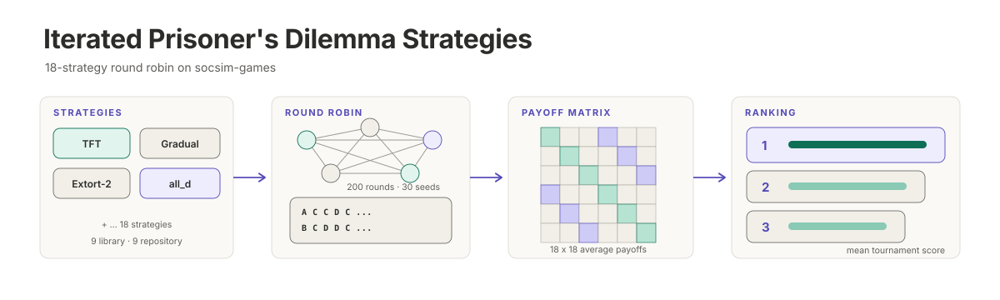

<p align="center"></p>

**English** | [日本語](README.ja.md)

# ipd-strategies

A round-robin tournament of 18 iterated prisoner's dilemma strategies, written in Rust on top of
[socsim-games](https://github.com/akitenkrad/rs-social-simulation-tools/tree/3b246d2/crates/socsim-games).
Nine strategies are built into socsim-games and nine are implemented here through its
`DecisionRule` trait. Every pair plays 200 rounds for seeds 0 to 29, and the program writes the
payoff matrix and the ranking as CSV files. This is the companion code for the Japanese-language
Zenn article
[ゲーム理論×シミュレーション: 囚人のジレンマにおける戦略と Rust による実装](https://zenn.dev/akitenkrad/articles/9d99e25e96f48b).

## Quick start

Requires a stable Rust toolchain. Run from the repository root:

```bash
# Run the round-robin tournament and write CSV files to out/
cargo run --release -q

# Run the tests
cargo test
```

## Documentation

- [Usage](docs/usage.md) — commands, the `legacy` mode, and the output CSV files
- [Strategies](docs/strategies.md) — the 18 strategies, the payoffs, and how the ranking is computed
- [Architecture](docs/architecture.md) — the source layout, where rule state lives, and the tests

## License

[MIT](LICENSE)
